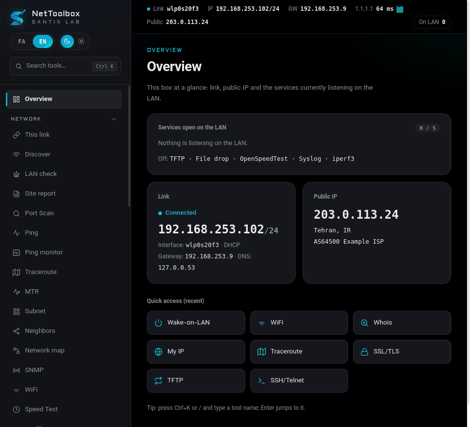

# NetToolbox

**v2.11.0** — a portable network & security dashboard for network engineers, system administrators, and field technicians.

One Docker container. One web UI. Run it on your laptop, workstation, server, home lab, or client site.

[](https://hub.docker.com/r/sajadprp/nettoolbox)
[](https://hub.docker.com/r/sajadprp/nettoolbox)
[](https://hub.docker.com/r/sajadprp/nettoolbox)
[](LICENSE)
[](https://www.docker.com/)
[](https://hub.docker.com/r/sajadprp/nettoolbox)



Demo walkthrough (sample lab data only — not a real customer network): This link, Subnet 10.20.30.0/24, Ping 1.1.1.1, DNS example.com, SHA-256, QR.

## Quick start

Docker Hub: https://hub.docker.com/r/sajadprp/nettoolbox

Tags: `sajadprp/nettoolbox:latest` · `sajadprp/nettoolbox:v2` · `sajadprp/nettoolbox:v2.11.0`

### 1. Pull the Docker image

```bash
docker pull sajadprp/nettoolbox:latest
```

Or pin a version:

```bash
docker pull sajadprp/nettoolbox:v2.11.0
```

### 2. Run NetToolbox

```bash
docker run -d \
  --restart unless-stopped \
  --net=host \
  --cap-add=NET_ADMIN \
  --cap-add=NET_RAW \
  -v "$HOME/.config/nettoolbox/ssh-keys:/data/ssh-keys" \
  -e NETTOOLBOX_HOST_UID="$(id -u)" -e NETTOOLBOX_HOST_GID="$(id -g)" \
  --name nettoolbox \
  sajadprp/nettoolbox:latest
```

### 3. Open the dashboard

```text
http://127.0.0.1:8642
```

That is it.

If a container named `nettoolbox` already exists: `docker rm -f nettoolbox` first.

## Why NetToolbox?

Network and IT technicians often need several different tools during a site visit:

- Network scanner
- Ping and traceroute
- Port scanner
- SSH/Telnet client
- RDP client
- DNS and Whois tools
- SSL certificate checker
- HTTP security header checker
- SNMP tools
- WiFi analyzer
- Subnet calculator
- Wake-on-LAN
- Hash and JWT utilities
- Network monitoring tools
- Cisco/MikroTik maps and a router security audit

NetToolbox brings these tools together in a single browser-based dashboard running inside Docker.

No desktop installation.
No separate applications.
No account required.

Just pull the Docker image and start the container.

## Run a specific version

```bash
docker run -d \
  --restart unless-stopped \
  --net=host \
  --cap-add=NET_ADMIN \
  --cap-add=NET_RAW \
  -v "$HOME/.config/nettoolbox/ssh-keys:/data/ssh-keys" \
  -e NETTOOLBOX_HOST_UID="$(id -u)" -e NETTOOLBOX_HOST_GID="$(id -g)" \
  --name nettoolbox \
  sajadprp/nettoolbox:v2.11.0
```

## Build from source

```bash
git clone https://github.com/sspiricco-dot/nettoolbox.git
cd nettoolbox
docker build -t nettoolbox .
./run.sh
```

`run.sh` starts the container with `--restart unless-stopped`. Enable Docker at boot if you want it back after a reboot (`sudo systemctl enable docker` on Linux, or start Docker Desktop on login on Mac/Windows).

**Copy a pre-built image to another laptop (USB, no rebuild)**

```bash
docker save nettoolbox:v2.11.0 nettoolbox:latest | gzip > nettoolbox-v2.11.0.tar.gz
gzip -dc nettoolbox-v2.11.0.tar.gz | docker load
mkdir -p ~/.config/nettoolbox/ssh-keys && chmod 700 ~/.config/nettoolbox/ssh-keys
docker run -d --restart unless-stopped --net=host \
  --cap-add=NET_ADMIN --cap-add=NET_RAW \
  -v "$HOME/.config/nettoolbox/ssh-keys:/data/ssh-keys" \
  -e NETTOOLBOX_HOST_UID="$(id -u)" -e NETTOOLBOX_HOST_GID="$(id -g)" \
  --name nettoolbox nettoolbox:v2.11.0
```

## Versions

`main` is always **v2**. v1 stays as a git tag.

| | v1 | v2.0 | v2.1 | v2.2 | v2.3 | v2.4 | v2.5 | v2.6 | v2.7 | v2.8 | v2.9 | v2.10 | **v2.11** |
|---|---|---|---|---|---|---|---|---|---|---|---|---|---|
| Discover, ping, traceroute, port scan | ✅ | ✅ | ✅ | ✅ | ✅ | ✅ | ✅ | ✅ | ✅ | ✅ | ✅ | ✅ | ✅ |
| SSH/Telnet in the browser | ✅ | ✅ | ✅ | ✅ | ✅ | ✅ | ✅ | ✅ | ✅ | ✅ | ✅ | ✅ | ✅ |
| SSL, headers, hash/JWT, DNS, WiFi, WoL | ✅ | ✅ | ✅ | ✅ | ✅ | ✅ | ✅ | ✅ | ✅ | ✅ | ✅ | ✅ | ✅ |
| In-browser RDP | ❌ | ✅ | ✅ | ✅ | ✅ | ✅ | ✅ | ✅ | ✅ | ✅ | ✅ | ✅ | ✅ |
| Link status / MTR / subnet / whois / export | ❌ | ✅ | ✅ | ✅ | ✅ | ✅ | ✅ | ✅ | ✅ | ✅ | ✅ | ✅ | ✅ |
| Host profiles | ❌ | ✅ | ✅ | ✅ | ✅ | ✅ | ✅ | ✅ | ✅ | ✅ | ✅ | ✅ | ✅ |
| SNMP, site report, script library | ❌ | ❌ | ✅ | ✅ | ✅ | ✅ | ✅ | ✅ | ✅ | ✅ | ✅ | ✅ | ✅ |
| WiFi QR | ❌ | ❌ | ❌ | ✅ | ✅ | ✅ | ✅ | ✅ | ✅ | ✅ | ✅ | ✅ | ✅ |
| Network map, OpenSpeedTest LAN | ❌ | ❌ | ❌ | ❌ | ✅ | ✅ | ✅ | ✅ | ✅ | ✅ | ✅ | ✅ | ✅ |
| Domain IPs + MikroTik list export, whois intel, router audit | ❌ | ❌ | ❌ | ❌ | ❌ | ✅ | ✅ | ✅ | ✅ | ✅ | ✅ | ✅ | ✅ |
| LAN file drop (download page + QR) | ❌ | ❌ | ❌ | ❌ | ❌ | ❌ | ✅ | ✅ | ✅ | ✅ | ✅ | ✅ | ✅ |
| TFTP server + client (start/stop, transfer log) | ❌ | ❌ | ❌ | ❌ | ❌ | ❌ | ❌ | ✅ | ✅ | ✅ | ✅ | ✅ | ✅ |
| Compression lab (Huffman, LZW, Deflate, bzip2, LZMA, Zstd, Brotli), quick/full Whois | ❌ | ❌ | ❌ | ❌ | ❌ | ❌ | ❌ | ❌ | ✅ | ✅ | ✅ | ✅ | ✅ |
| SSH key manager (generate, install on server, key login in terminal) | ❌ | ❌ | ❌ | ❌ | ❌ | ❌ | ❌ | ❌ | ❌ | ✅ | ✅ | ✅ | ✅ |
| Overview page, tool search (Ctrl+K), mobile layout, bookmarkable tabs | ❌ | ❌ | ❌ | ❌ | ❌ | ❌ | ❌ | ❌ | ❌ | ❌ | ✅ | ✅ | ✅ |
| SSL files → fullchain.pem / privkey.pem (PFX, P7B, AIA fetch) | ❌ | ❌ | ❌ | ❌ | ❌ | ❌ | ❌ | ❌ | ❌ | ❌ | ❌ | ✅ | ✅ |
| Slim image (~130 MB pull, was ~290 MB), CDP/LLDP without tshark | ❌ | ❌ | ❌ | ❌ | ❌ | ❌ | ❌ | ❌ | ❌ | ❌ | ❌ | ❌ | ✅ |

```bash
git clone --branch v1.0.0 https://github.com/sspiricco-dot/nettoolbox.git nettoolbox-v1
```

## Features

### Network tools

**Network discovery** — ARP and ping sweep on the LAN, well-known port checks, topology view, CSV/JSON export.

**Port scanner** — custom list, range, or 1–65535.

**Ping** — one-shot check or live latency monitor.

**Traceroute** — hop-by-hop path.

**MTR** — live hop latency and loss.

**Subnet calculator** — IPv4 CIDR, broadcast, usable range, typical gateway, split.

**Neighbor discovery** — CDP and LLDP.

**Network map** — paste Cisco running-config / CDP or MikroTik export / IP neighbor; layered topology SVG and a customer Excel (devices, VLANs, links, IPs).

**SNMP** — GET/WALK, community v1/v2c. Switches, printers, UPS, cameras, Dahua, Hikvision. Hostname, uptime, port names, VLANs.

**WiFi analyzer** — nearby SSIDs, signal, frequency (needs a wireless interface).

**Speed test** — download, upload, ping via Cloudflare, then Hetzner / OVH / others if one is blocked. Self-hosted [OpenSpeedTest](https://openspeedtest.com/) on this laptop for LAN tests; start it from the Speed Test tab, then stop so port 3000 is not left open.

**Wake-on-LAN**, **ARP table**, **live bandwidth** (RX/TX per interface).

**Link status** — interface IP, gateway, DNS, DHCP vs static, public IP.

### Security tools

**DNS lookup** — A, AAAA, MX, TXT, NS, CNAME, SOA.

**Whois** — domain and IP. Quick by default (resolved IPs, location, ISP). Tick "Full details" for raw whois, abuse DNSBLs, owner/org, ping, and OS guess (nmap or TTL).

**Public IP / geolocation** — yours or any IP, with fallbacks if ipinfo is unreachable.

**Domain recon** — DNS A/AAAA for the domain and subdomains from public SSL certificates (crt.sh). Export notepad text or a MikroTik address-list `.rsc` with a name you choose. Passive lookup; nothing is sent to the target host for subdomain discovery.

**Router audit** — SSH or Telnet to MikroTik or Cisco (same user as Winbox on SSH). Status dashboard and common holes: open management services, unrestricted dst-nat, MAC Winbox, discovery, bandwidth-server, weak Cisco passwords. Read-only; suggested fix commands to copy. Password is not stored. Winbox itself is not a login protocol.

**SSL/TLS inspector** — public, internal, and self-signed certificates.

**HTTP security headers** — HSTS, CSP, X-Frame-Options, and similar.

**Hash / Base64 / JWT** — MD5, SHA-1/256/384/512, Base64, JWT decode, all in the browser.

### Remote access

**SSH / Telnet** — full terminal in the browser via [ttyd](https://github.com/tsl0922/ttyd). Type the password in the terminal after connect.

**RDP** — Windows desktop in the browser (FreeRDP + noVNC). Internal/self-signed certs are ignored. Shared drive for Windows scripts in the session.

### Host profiles

Save hostname, protocol, port, username, and site notes. Passwords are not stored.

### Script library

Windows, Linux, and MikroTik templates with `{{VARIABLES}}`. Edit, copy, download, or run over SSH. From the SSH/Telnet or RDP tab you can run the same scripts on the host you are already connected to.

### Site visit report

Last discover + neighbors + link status + notes. Download Markdown or text for a ticket.

### QR codes

Text, URL, or WiFi join. Copy or download PNG. WiFi QR from this laptop’s network or typed by hand.

### SSL files → fullchain.pem / privkey.pem

In the SSL/TLS tab, drop everything a CA or customer sent (`.crt`, `.cer`, `.ca-bundle`, `.p7b`, `.pfx`/`.p12`, `.key`, in any order, or paste PEM text). NetToolbox:

- finds the site certificate that matches the private key (and says so when the key does not match),
- orders the chain leaf → intermediates and stops at a root in the system trust store,
- downloads a missing intermediate from the CA (AIA `caIssuers`) when the bundle is missing,
- opens PFX/P12 and encrypted keys with the password you give,
- produces `fullchain.pem`, `privkey.pem` (unencrypted PKCS#8), `cert.pem`, `chain.pem`, one by one or as a zip, plus an nginx/Apache example.

Files are processed in memory; private keys are never written to disk.

### LAN file drop

Put a firmware image, PDF, or script on this laptop. Start sharing from the File drop tab; phones and other PCs on the same LAN open a clean download page (link or QR). Stop sharing and port 8765 closes. LAN visitors can only download; uploads stay on the dashboard.

### SSH keys

Generate Ed25519, RSA 4096/3072, or ECDSA keys (optional passphrase) or import an existing private key. Each key shows its SHA256 and MD5 fingerprints and a one-click **Copy public key** for Hetzner, other cloud panels, or `authorized_keys`. **Install key on server** logs in once with the password and appends the key (like `ssh-copy-id`; the password is not stored). **Test key login** checks a key-only login, and the SSH/Telnet terminal has a key picker so you connect without a password.

Keys are stored on the host in `~/.config/nettoolbox/ssh-keys` (mounted by `run.sh`, owned by your user), so they survive container rebuilds and also work from the laptop: `ssh -i ~/.config/nettoolbox/ssh-keys/<name> root@<server>`. The tab warns if that folder is not mounted.

### Compression lab

Drop a file or paste text and compare Huffman, LZW, Deflate/gzip, bzip2, LZMA/xz, Zstandard, and Brotli side by side: compressed size, ratio, bits per byte, compress/decompress time, and a round-trip check. The order-0 entropy is shown as the floor for byte-wise coders. Huffman (canonical, codes limited to 15 bits) and LZW (9–16 bit codes) are implemented in pure Python, with their own `.huff` / `.lzw` formats. The Huffman card shows the code table (symbol, count, probability, code) and the coding efficiency against entropy. Any algorithm's output can be downloaded, and the Decompress box detects `.huff .lzw .gz .bz2 .xz .zst .br` automatically. Levels: fast, balanced, max. Limits: 16 MB for Huffman/LZW, 64 MB for comparison. Everything runs locally.

### TFTP

Server and client for switches and routers. Start the server from the TFTP tab (UDP 69 by default, read-only or read/write), drop an IOS image or firmware into its folder, and the tab shows ready-to-copy commands (`copy running-config tftp://…`, `copy tftp://… flash:`, MikroTik `/tool fetch`). Configs that devices upload appear in the same list for download. The client gets/puts files from another TFTP server with live progress. Supports blksize/tsize/timeout options and files over 32 MB. Every transfer is logged.

If the host already runs a TFTP server on UDP 69 (`tftpd-hpa`, `dnsmasq`), stop it or pick another port; Cisco IOS normally only talks to 69.

### Interface

Persian and English. Light and dark themes. Single HTML page, no CDN; the Vazirmatn font ships inside the image.

- **Overview** (first page): link, gateway, public IP, and every service currently listening on the LAN (TFTP, file drop, OpenSpeedTest) with a stop button. Listening tools also get a green dot in the sidebar.
- **Tool search**: press `Ctrl+K` or `/`, type part of a name (`tft`, `ssh`, `کلید`), Enter.
- **Bookmarkable tabs**: every tool has its own URL (`http://127.0.0.1:8642/#tftp`), and refresh stays on it.
- **Mobile**: on a phone the sidebar becomes a ☰ drawer, forms stack full-width, wide tables scroll sideways.
- Sidebar groups fold; the fold state is remembered.

## Docker configuration

```bash
docker run -d \
  --restart unless-stopped \
  --net=host \
  --cap-add=NET_ADMIN \
  --cap-add=NET_RAW \
  -v "$HOME/.config/nettoolbox/ssh-keys:/data/ssh-keys" \
  -e NETTOOLBOX_HOST_UID="$(id -u)" -e NETTOOLBOX_HOST_GID="$(id -g)" \
  --name nettoolbox \
  sajadprp/nettoolbox:latest
```

**`--net=host`** — the container sees the host’s real interfaces. Needed for ARP, discovery, CDP/LLDP, SNMP, WoL, and LAN analysis.

**`NET_ADMIN` / `NET_RAW`** — required by nmap, ping/traceroute, and the CDP/LLDP listener (raw sockets).

## Web interface ports

| Service | Port | Bind |
|---|---:|---|
| Dashboard | 8642 | loopback (`127.0.0.1`) |
| Web terminal | 7681 | loopback |
| RDP / noVNC | 7682 | loopback |
| OpenSpeedTest | 3000 | LAN, **only while started** from the Speed Test tab |
| File drop | 8765 | LAN, **only while started** from the File drop tab |
| TFTP | 69/udp (configurable) | LAN, **only while started** from the TFTP tab |

Dashboard:

```text
http://127.0.0.1:8642
```

The UI, terminal, and RDP viewer are **not** published on the LAN even with host networking. Only processes on this machine can reach them. OpenSpeedTest, File drop, and TFTP are the exceptions, and only while you leave them on.

## Security notes

This tool is powerful. Understand what it does before you run it.

- **Host networking + `NET_ADMIN`/`NET_RAW`**: the container can see and send packets on whatever network you plug into.
- **Dashboard / terminal / RDP are loopback-only** (`8642`, `7681`, `7682`).
- **OpenSpeedTest (`:3000`) is off until you start it.** Other devices on the LAN can then measure speed to this laptop (static HTML/JS, no shell). Stop it when you are done.
- **File drop (`:8765`) is off until you start it.** Other devices on the LAN can then download the files you staged. The LAN page is read-only (no upload, no directory escape). Stop it when you are done.
- **SSH private keys** stay in `~/.config/nettoolbox/ssh-keys` (mode 700/600). Only the public key is meant to leave the laptop; set a passphrase on keys you download or copy elsewhere.
- **TFTP (UDP `69`) is off until you start it.** TFTP has no authentication: while it runs, anyone on the LAN can read the TFTP folder, and write to it if uploads are allowed. Paths cannot leave that folder. Stop it when you are done.
- **The terminal is a real shell** with ssh/telnet and the container’s privileges.
- **RDP passwords** go to FreeRDP on stdin, not on the command line.
- **Internet-connected features**: Speed Test (Cloudflare and other CDNs as fallbacks), public IP / geolocation, domain recon (crt.sh, DNS), Whois, abuse DNSBLs. Router audit talks only to the device you name over SSH/Telnet. Scanning, ARP, CDP/LLDP, RDP, hashing, OpenSpeedTest LAN, File drop, TFTP, and the compression lab stay local.
- Run only on hardware and networks you are authorized to administer. Do not expose the dashboard beyond loopback unless you add your own authentication.

## Updating

```bash
docker pull sajadprp/nettoolbox:latest
docker rm -f nettoolbox
docker run -d \
  --restart unless-stopped \
  --net=host \
  --cap-add=NET_ADMIN \
  --cap-add=NET_RAW \
  -v "$HOME/.config/nettoolbox/ssh-keys:/data/ssh-keys" \
  -e NETTOOLBOX_HOST_UID="$(id -u)" -e NETTOOLBOX_HOST_GID="$(id -g)" \
  --name nettoolbox \
  sajadprp/nettoolbox:latest
```

Treat container state as disposable unless you mount your own volumes. The `-v …/ssh-keys` mount keeps SSH keys from the SSH keys tab across rebuilds; without it the tab shows a warning.

## Linux / Windows / macOS

Linux is the most predictable for discovery because Docker uses the host network namespace.

```bash
sudo systemctl enable docker
sudo systemctl start docker
```

On Windows and macOS, use Docker Desktop. Host-network and raw sockets often run inside a VM, so ARP/CDP/WiFi may not see the physical NIC the way they do on Linux. PowerShell example:

```powershell
docker pull sajadprp/nettoolbox:latest
docker run -d `
  --restart unless-stopped `
  --net=host `
  --cap-add=NET_ADMIN `
  --cap-add=NET_RAW `
  -v "${HOME}/.nettoolbox/ssh-keys:/data/ssh-keys" `
  --name nettoolbox `
  sajadprp/nettoolbox:latest
```

## Docker Hub

**https://hub.docker.com/r/sajadprp/nettoolbox**

```text
sajadprp/nettoolbox:latest
sajadprp/nettoolbox:v2
sajadprp/nettoolbox:v2.11.0
```

## How it compares

| | NetToolbox | [NETworkManager](https://github.com/BornToBeRoot/NETworkManager) | Angry IP Scanner | Fing |
|---|---|---|---|---|
| Platform | Any (Docker) | Windows only | Cross-platform | Mobile + desktop |
| Interface | Browser | Native WPF | Native app | Native app |
| Install | One container | .NET/WPF | Java | App install |
| SSH/Telnet | ✅ in-browser | ✅ | ❌ | ❌ |
| RDP | ✅ in-browser | ✅ | ❌ | ❌ |
| Cert / header / hash | ✅ | ❌ | ❌ | ❌ |
| No account | ✅ | ✅ | ✅ | Partial |

NetToolbox is a portable field kit, not a replacement for a full Windows admin suite.

## Tech stack

Python/Flask calling `nmap`, `dig`, `iw`, `mtr`, `traceroute`, `curl`; CDP/LLDP, SNMP, TFTP, compression and certificate handling are pure Python. The image ships only what the dashboard calls (~540 MB on disk, ~130 MB compressed pull). LAN speed test: [OpenSpeedTest](https://github.com/openspeedtest/Speed-Test) (MIT) via nginx on `:3000`. Frontend: one HTML/CSS/JS file, no CDN. Terminal: [ttyd](https://github.com/tsl0922/ttyd). RDP: [FreeRDP](https://github.com/FreeRDP/FreeRDP) + [noVNC](https://novnc.com). QR: [qrcode-generator](https://github.com/kazuhikoarase/qrcode-generator) (MIT), bundled in `static/qrcode.js`.

## License

MIT — see [LICENSE](LICENSE).

---

ممنون میشم نظرتون رو بدونم.
